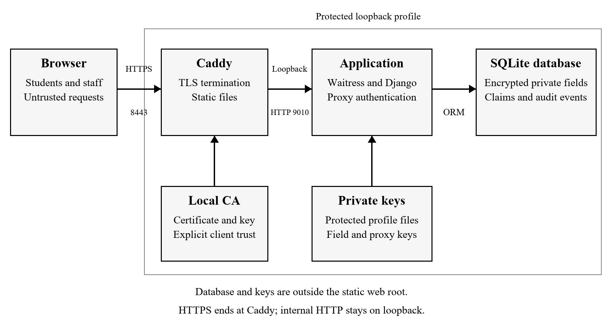
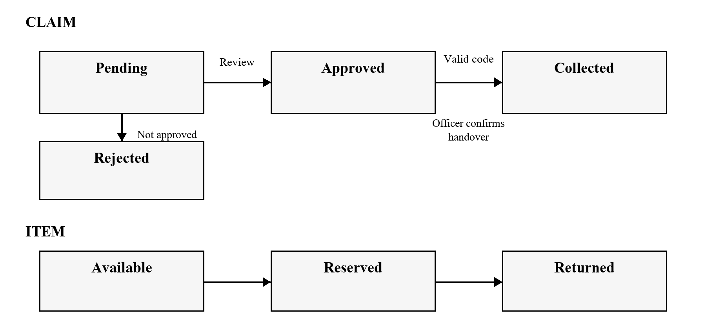
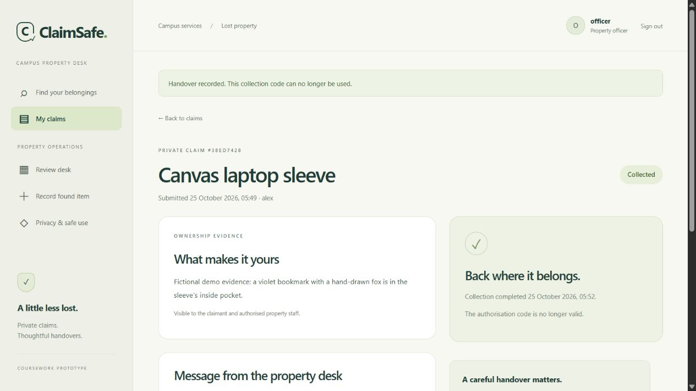
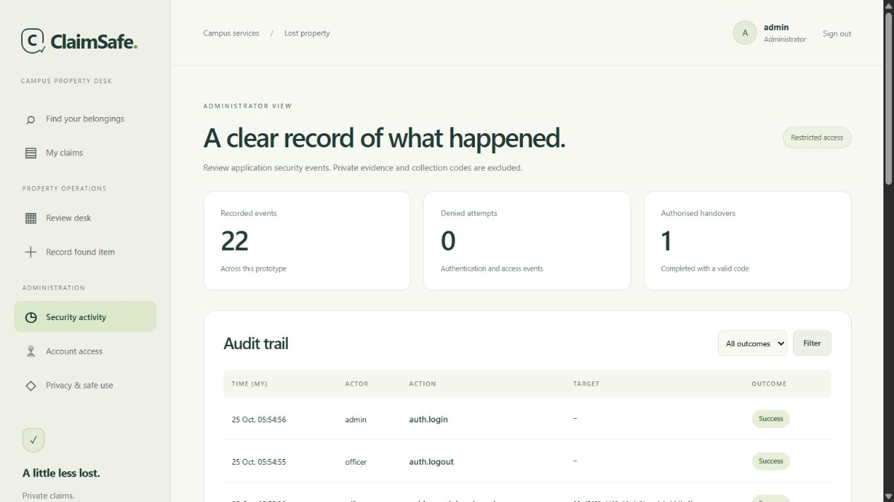

# ClaimSafe Secure Campus Lost Property Claim and Collection System

Security 6000CMD and 6005CEM

Secure Application Development and Implementation

26 October 2026

## Abstract

ClaimSafe is a campus lost property application that supports public item discovery while keeping ownership evidence private. The project examines how a legitimate service can be misused when users request other people's records, alter their permissions or repeat an authorised action. Its design separates student, property officer and administrator responsibilities and treats collection as a controlled workflow. Django provides authentication and browser security mechanisms, while application checks restrict access to individual claims. Private evidence is encrypted with Fernet, and an expiring collection code connects an approved claim to a recorded handover. Conditional database updates and a single transaction prevent the same authorisation from completing two collections. Forty-five automated tests passed in the local Windows and SQLite environment, including access restrictions, rejected inputs and concurrent collection attempts. A separate browser walkthrough demonstrated the permitted process using fictional records. The results support the implemented application controls, although HTTPS deployment, host hardening and a broader vulnerability assessment remain necessary before operational use.

## 1.0 Introduction and System Overview

### 1.1 System Overview

ClaimSafe is a web application for managing lost property on a campus. It allows students to browse found items, submit ownership evidence and follow the outcome of their claims. Property officers record items received into custody, review the evidence and confirm collection. The application separates public descriptions from private identifying details because publishing a serial number, engraving or description of an item's contents could help another person make a false claim. Staff approval is therefore required before an item can be collected.

### 1.2 System Users and Objectives

The system has three user roles: student, property officer and administrator. A student can register an account and access their own claims. Officers can record found items, review competing claims and confirm an approved collection. Administrators can perform those operational tasks and also review security activity and control account activation. Public registration creates only a student account. Officer and administrator accounts must be created locally through a management command.

The project aims to restrict access to private claims, protect identifying information and prevent an item from being collected before approval or collected more than once. It also addresses malicious input, session misuse and insufficient activity records. ClaimSafe was developed as a new application with these requirements considered during design and implementation.

### 1.3 Project Scope

ClaimSafe uses server-rendered Django pages, a SQLite database and the cryptography library. The examined version uses Python 3.12.14, Django 5.2.18 and cryptography 46.0.7 on Windows. Its scope is one campus, text descriptions and collection in person. It does not process payments, accept identity-document uploads or automatically establish legal ownership. Demonstration records are fictional, and officers remain responsible for assessing claims.

## 2.0 Security Analysis and Design

### 2.1 System Assets and Trust Boundaries

The most sensitive application records are the identifying details withheld from public listings and the evidence supplied by claimants. Their disclosure could support an ownership fraud or reveal personal information. Credentials and session identifiers protect access to those records, while approval states and collection authorisations govern whether an item can leave custody. Audit records provide an account of the decision and the person who performed it. The security analysis consequently considers misuse by authenticated users as well as attacks from outside the service.

The browser is treated as untrusted. Hidden form fields, request identifiers and disabled buttons cannot establish a person's permissions. Authentication identifies an account, while authorisation determines whether that account may perform a particular operation on a particular record. OWASP recommends checking permissions for each request and denying access unless permission has been established (OWASP Foundation, n.d.-a). ClaimSafe applies role checks to staff functions and an ownership condition when a student requests a claim.

Figure 1 shows the browser, application and storage boundaries. The application can decrypt private fields for authorised users, which makes the server operator a trusted party. Physical collection introduces a further boundary. The application can establish that a code belongs to an approved claim and record an officer's confirmation, but it cannot determine who is standing at the desk. Requiring that confirmation connects the software workflow to a staff responsibility without treating possession of a code as independent proof of ownership.



### 2.2 Access Control

Table 1 summarises the access model. Students can read their own evidence and the staff message about their outcome. Officers can inspect private identifying information and claims, but cannot approve or confirm collection of their own claim. Administrators can restrict account access and review the audit dashboard. A staff role does not imply that every administrative operation is available.

Table 1 Role and resource access

| Capability | Student | Officer | Administrator |
| --- | --- | --- | --- |
| Browse public listings | Yes | Yes | Yes |
| Read private claims | Own claims | Operational claims | Operational claims |
| Read withheld item details | No | Yes | Yes |
| Review and confirm collection | No | Other people's claims | Other people's claims |
| View system audit and manage activation | No | No | Yes |

The item form provides separate fields for the public description and private identifying details. The public template displays only the description, while authorised staff can read the identifying details when reviewing a claim. The form also explains which information belongs in each field. This reduces the chance of publishing evidence that another person could repeat, although an officer could still enter sensitive details into the wrong field. Staff must therefore retain enough private information to assess ownership while providing a useful public description.

Saltzer and Schroeder (1975) describe least privilege as limiting authority to what a task requires. Here, the need to submit evidence does not justify reading another student's evidence. Role checks establish the available functions, and an ownership condition narrows the student's access within those functions. Staff access is broader because officers handle competing claims, although this also makes a compromised staff account more consequential. The design assumes that operational staff are authorised to inspect all claims within this single-campus prototype.

### 2.3 Security Risks and Workflow Requirements

The threat assessment prioritises consequences for ownership evidence and physical release. Table 2 records qualitative priorities based on the affected asset and the available request paths. These priorities express design judgement rather than measured attack frequencies. Cross-account access and repeated collection receive particular attention because a successful request could defeat the service even when login and page rendering work correctly. Compromised staff accounts and mistakes by legitimate users are considered alongside requests from unauthenticated attackers.

Table 2 Prioritised threats

| Threat | Priority | Reason and proposed response |
| --- | --- | --- |
| Reading another person's claim | High | Exposes private evidence; enforce ownership on every retrieval |
| Skipping approval or repeating collection | High | Can release an item incorrectly; enforce state and single use |
| Account or session compromise | High | Exposes permitted actions; strengthen authentication and sessions |
| Injection and malicious displayed content | High | Threatens records or users; validate, parameterise and encode |
| Network interception | High | Local HTTP does not protect transmitted credentials; deploy HTTPS |
| Missing or altered audit records | Moderate | Weakens investigation; restrict access and improve log protection |

The workflow has explicit states. An item moves from available to reserved and then returned. A claim moves from pending to approved and collected, or from pending to rejected. Approval reserves the item and closes other pending claims without revealing the successful claimant. Figure 2 shows these permitted transitions. OWASP's business logic guidance recommends modelling workflows on the server and testing attempts to skip, repeat or race their steps (OWASP Foundation, n.d.-b).



Collection requires more than a valid session. Only the approved claimant can request a code, and an authorised officer must validate that code against the same claim. Expiry limits its lifetime, while recorded consumption prevents reuse. OWASP distinguishes limited validity from accepting an authorisation only once; the final execution must enforce both (OWASP Foundation, n.d.-d). The database transaction is therefore part of the security control.

### 2.4 Data Protection and Host Security

Private evidence is encrypted before storage, while passwords use a dedicated password hashing mechanism. The distinction matters because staff need to recover evidence for assessment but never need to recover a user's original password. The design uses maintained library functions rather than a custom encryption algorithm. Key compromise, backup handling and authorised staff access remain separate risks.

Malaysia's published personal data protection guidance identifies notice, disclosure, security, retention, integrity and access among its principles (Ministry of National Unity, n.d.). These inform the proposed handling of campus records: collect limited information, explain its purpose and restrict its audience. Whether a real deployment falls within particular legal obligations depends on the operator and processing context. A fictional prototype and a privacy checkbox do not demonstrate compliance.

The environment design requires HTTPS and protected host access because application permissions cannot protect credentials intercepted in transit or files read directly from the server. A trusted certificate must identify the intended service, and its application identity should have access only to the files required to run it. This extends the same principle of limited authority from individual application users to the host environment.

## 3.0 Security Implementation

### 3.1 User Registration and Authentication

Registration uses an explicit field list and assigns the student role on the server. Officer and administrator accounts are created through a management command with an interactively entered password. This separates public account creation from privileged provisioning. The registration test submits administrator and staff parameters deliberately, then checks that the resulting account is still a student without elevated framework flags. The result verifies the server's decision independently of the fields displayed by the form.

Passwords are processed through Django's password API, whose default storage uses salted PBKDF2 with SHA-256 (Django Software Foundation, n.d.-b). Tests confirm that the database value differs from the submitted password and that normal verification succeeds. The configured validators reject common, numeric and account-similar passwords and require twelve characters. The application delegates password storage and verification to the framework so that authentication does not depend on a custom reversible credential field.

Login attempts are limited through database counters keyed from account or network identifiers using a keyed hash. The account window allows five attempts in fifteen minutes, while the network window allows thirty. Requests already blocked by the network limit do not allocate additional account counters. Failed attempts and throttling outcomes generate audit events without recording submitted passwords. These limits also affect legitimate repeated attempts and require operational review before real use.

Django changes the session identifier at login, and logout invalidates the session. ClaimSafe adds an authentication timestamp and rejects sessions older than eight hours, while configured session expiry provides a thirty-minute inactivity boundary. Session cookies use HttpOnly and SameSite settings. Automated checks cover session rotation, logout and absolute expiry. Deactivated accounts also lose authenticated access on subsequent requests. Secure cookie transmission remains dependent on the unfinished HTTPS deployment.

### 3.2 Authorisation and Access Control

Claim retrieval is scoped before a private record is returned. A student lookup includes the authenticated claimant, while an officer enters through the staff permission check. Requesting another student's identifier therefore produces a generic unavailable-page response. The corresponding test signs in as a different student, requests the exact claim and checks both the response status and absence of private evidence. This addresses an object access risk that would remain if the application checked only whether the requester had logged in.

Registration, claim status and officer permissions are never accepted from client assertions. State-changing operations require POST, and staff routes reject student accounts even when called directly. Officers cannot open the administrator audit view or change account activation. Administrators cannot deactivate themselves or another administrator through the provided route. The database supplies an additional unique constraint so that an item cannot have two approved or collected claims.

### 3.3 Input Validation and Error Handling

Django forms constrain the values expected by each operation. Evidence must contain between twenty and 2,000 characters, public descriptions have a 300-character limit, and future found dates are rejected. These rules keep records meaningful and bounded. A claimant still needs enough space to explain a distinctive detail, so validation is based on the expected data rather than a short list of prohibited characters.

Database lookups use Django's object relational mapper (ORM) rather than concatenating submitted text into SQL. Django's security documentation explains how parameterised queries keep supplied values separate from query structure (Django Software Foundation, n.d.-c). A regression test submits SQL-like search input, observes no matches and confirms that the item table remains intact. The test exercises the search path used by the application and preserves the database assertion as evidence of its outcome.

Templates retain automatic escaping, and user text is not marked as trusted HTML. The stored-script test places script-like text in encrypted evidence and confirms that its displayed response contains encoded markup. A Content Security Policy also disallows script execution. Django's cross-site request forgery (CSRF) middleware protects submitted forms, and a test using enforced CSRF checks rejects a staff review without its token. Custom error pages avoid sending tracebacks to visitors. These controls complement one another rather than making validation a substitute for output encoding or authorisation.

### 3.4 Data Protection and User Education

Identifying details, claim evidence and review messages are encrypted with Fernet before they are written to the database. Fernet combines AES-128-CBC encryption with HMAC-SHA256 authentication and random initialisation values (Python Cryptographic Authority, n.d.). The application delegates the cryptographic construction to the library. A test verifies recovery of the original evidence and rejection of a modified encrypted value.

Local setup generates a field encryption key independently of Django's secret key. It does not overwrite existing key material and refuses to generate replacement keys beside an existing database missing its secrets. The keys, database, demonstration passwords and virtual environment are excluded from Git. This prevents accidental version-control disclosure, although those files remain within the same local checkout area. Their host permissions and backup separation have not been independently established.

The privacy page explains the data collected, authorised audiences and the limits of encryption. Forms warn against submitting passwords, device PINs, payment information or identity numbers. The application deliberately excludes document uploads, reducing the sensitive information required to make a claim and avoiding a separate file-handling workflow. This makes user education part of the point where evidence is requested, rather than relying only on a privacy page that a student may not open.

### 3.5 Claim Approval and Collection

Approval is performed inside a database transaction. The service checks the reviewer, rejects self-review and changes an available item to reserved using a conditional update. If that update fails, approval stops. A unique winning-claim constraint provides a second check on the resulting records. The application then closes competing pending claims with a neutral message. This maintains a consistent outcome without publishing another claimant's identity.

An approved claimant can generate a collection code from twenty-four random bytes, providing 192 bits of random input before encoding. The database stores its SHA-256 digest rather than the code itself. It belongs to one claim, expires after fifteen minutes and is shown only in the generating response, which is marked no-store. Issuing another code replaces the earlier digest. This lets a student recover from a lost code without keeping multiple valid authorisations for the same collection.

The officer must provide that code and confirm the physical handover. The transaction conditionally consumes an unused, unexpired matching digest, changes the approved claim to collected, changes the reserved item to returned and records the completed collection. Any failed required update rolls the transaction back. Figure 3 records the resulting state during a fictional browser walkthrough; it illustrates the completed workflow rather than proving physical ownership.



SQLite is configured to use IMMEDIATE transactions. This acquires the write reservation before the transaction's decision reads, while conditional updates still verify the expected state. Django documents that SQLite does not implement SELECT FOR UPDATE row locking, so relying on that mechanism here would be misleading (Django Software Foundation, n.d.-a). The concurrent test uses separate connections and a shared start barrier. One collection succeeds, the other is rejected, and one completion event remains.

### 3.6 Logging and Analytics

The audit model records the actor, action, target, outcome and timestamp. Events include login failures, access denials, private evidence access, claim decisions and collection completion. Students see their own activity, while the system audit dashboard is restricted to administrators. It provides outcome filtering and totals for recorded events, denied attempts and authorised handovers.

Passwords, collection codes and evidence text are excluded from these events. This follows OWASP's distinction between recording security activity and exposing secrets through logs (OWASP Foundation, n.d.-c). Figure 4 shows the dashboard during the fictional walkthrough; its totals represent that capture, not a measured attack rate. The database remains modifiable by its operator, so restricted dashboard access does not provide an independently tamper-proof audit trail.



### 3.7 Secure Communication and Host Security

The examined server was bound to 127.0.0.1 and used HTTP for local development. DEBUG was disabled, allowed hostnames were restricted, and responses included framing, content-type and content-policy protections. A production settings switch enables HTTPS redirection, Secure cookies and HTTP Strict Transport Security (HSTS). However, no deployed certificate, trusted Transport Layer Security (TLS) endpoint or hardened production server has been verified. Those settings cannot be presented as completed secure communication.

The production switch concerns application responses and cookie policy. It does not install a server certificate or restrict operating-system access to key files. TLS termination and host permissions therefore remain separate implementation tasks. Their verification needs to examine the client connection and the application identity's file access, including whether proxy forwarding headers are accepted only from a trusted intermediary.

### 3.8 Security Testing and Results

The implementation examined in this report is repository commit d1086b5. On 26 October 2026, the Django test runner completed forty-five tests successfully using a separate SQLite database. Table 3 selects results that assess permissions and workflow failures. These automated regression tests exercise application behaviour and assertions rather than measuring production performance. The complete test source records the setup and expected database outcomes for each case.

Table 3 Selected automated checks from the passing test run

| Check | Observed result |
| --- | --- |
| Student requests another student's claim | Generic 404 response; evidence absent |
| Registration supplies administrator fields | Account remains a student |
| Script-like evidence is displayed | Markup encoded; script execution disallowed |
| Staff review omits a CSRF token | Request rejected with status 403 |
| Expired, replaced or wrong-claim code is used | Collection rejected |
| Failed final state update | Code consumption and claim update rolled back |
| Two connections collect the same claim | One success, one rejection, one completion event |
| Account is deactivated with an existing session | Authenticated access denied on the next request |

Browser observation separately exercised student and officer sign-in, code generation, a fictional handover and the administrator dashboard. The home layout was also inspected at desktop size and a 390-pixel mobile viewport. These observations establish visible behaviour in that environment; no independent usability study or physical campus trial was conducted.

These results provide a regression baseline for further assessment. OWASP's testing guide offers more specific activities for examining authentication, permissions and workflow misuse beyond the existing cases (OWASP Foundation, n.d.-e). The scope of that remaining assessment and its relationship to the current evidence are considered in Section 4.3.

## 4.0 Discussion

### 4.1 Evaluation of the Security Controls

The results support the main application boundaries. A student cannot obtain another student's evidence by changing the claim identifier, and an officer needs the expected claim state and code to complete a handover. The concurrent test is particularly relevant because it examines two requests that are individually plausible but invalid when both attempt the same release. Keeping token consumption and the related records in one transaction prevents a partially completed operation from being treated as a successful collection. The browser walkthrough separately shows that a permitted collection remains possible through the interface.

Controlled disclosure also affects convenience. Withheld details can make an item harder to recognise, and staff review delays collection compared with automatic matching. Publishing more evidence would reduce the information available for distinguishing a genuine owner from another interested person. The chosen workflow therefore gives staff a private comparison rather than treating a public match as sufficient. Someone who already knows the identifying details could still make a convincing claim, which preserves a role for staff judgement and custody procedures.

SQLite made transaction behaviour a concrete design issue. Conditional updates and IMMEDIATE transactions produced the required outcome in the local tests, but SQLite serialises writers. The result does not establish capacity for a busy campus service. Moving to another database would require the locking and failure behaviour to be reviewed and the concurrency tests repeated. This reflects a wider lesson from the implementation: a security API needs to be understood in the environment where it is actually used.

### 4.2 Limitations

The password setting is a concrete improvement area. ClaimSafe currently accepts twelve-character passwords without MFA. NIST's 2025 guidance specifies at least fifteen characters for passwords used as a single authentication factor (NIST, 2025). That guidance is a technical benchmark rather than a statement of this application's legal obligations. Increasing the minimum, reviewing compromised-password screening and introducing MFA for privileged accounts would strengthen the authentication design.

Other gaps concern operation over time. The prototype has no protected external log copy, automated alerting, tested backup recovery or implemented key rotation. Old rate counters also require periodic cleanup. The privacy notice identifies data use but is not accompanied by an established retention schedule or complete deletion and correction process. These matters should be resolved with the intended operator before processing real records.

The OWASP Top 10 2025 provides a useful classification of these concerns, including access control, injection, configuration and logging (OWASP Foundation, 2025). The targeted checks address particular request paths within those areas. An assessment must still examine the remaining paths and configuration, with findings tied to reproducible actions and the affected version.

### 4.3 Future Improvements

Verified HTTPS and host protection should precede use with real records. The next assessment should combine manual attempts to alter identifiers and workflow requests with an automated web scan and dependency vulnerability audit. Findings need an affected version, reproducible steps, a justified correction and a retest. The current forty-five tests can then check that those changes preserve the existing permission and collection boundaries. No complete manual security assessment, web vulnerability scan or dependency vulnerability audit has yet been carried out.

After these immediate gaps, recovery and operational controls need practical exercises. A protected backup should be restored and its evidence decrypted successfully; key rotation should preserve access to existing records. Retention and deletion procedures should be agreed with the intended operator. External audit protection and useful alerts would improve investigation of staff misuse. These improvements follow from the application's trust assumptions and current coverage, extending the evaluation from individual requests to the operation of the service over time.

## 5.0 Conclusion

ClaimSafe implements a campus lost-property workflow in which public discovery is separated from private ownership assessment. Students can submit and follow their own claims, officers can assess evidence and confirm another person's collection, and administrators can inspect security activity and restrict account access. The application's distinctive security requirement is that approval and physical handover must remain controlled even when a user sends requests outside the visible interface.

The local implementation combines framework authentication, ownership checks, validated forms, escaped output, encrypted private fields and recorded security events. Its collection service binds an expiring code to an approved claim and changes the related records within one transaction. Forty-five automated tests passed, including a two-connection collection case, and a fictional browser walkthrough demonstrated a permitted handover.

These results support the implemented controls within the local Windows and SQLite environment. HTTPS deployment, host hardening and broader manual and automated assessment remain the main unfinished areas. Completing them will extend the evidence from the implemented application to the environment in which a real campus service would operate.

## 6.0 References

Django Software Foundation (n.d.-a) Databases. Available at: https://docs.djangoproject.com/en/5.2/ref/databases/ (Accessed: 25 October 2026).

Django Software Foundation (n.d.-b) Password management in Django. Available at: https://docs.djangoproject.com/en/5.2/topics/auth/passwords/ (Accessed: 25 October 2026).

Django Software Foundation (n.d.-c) Security in Django. Available at: https://docs.djangoproject.com/en/5.2/topics/security/ (Accessed: 25 October 2026).

Ministry of National Unity (n.d.) Personal Data Protection. Available at: https://www.perpaduan.gov.my/index.php/en/services/other-services/e-participation/personal-data-protection (Accessed: 25 October 2026).

National Institute of Standards and Technology (NIST) (2025) Digital Identity Guidelines Authentication and Authenticator Management. NIST SP 800-63B-4. Available at: https://pages.nist.gov/800-63-4/sp800-63b.html (Accessed: 25 October 2026).

OWASP Foundation (2025) OWASP Top 10 2025. Available at: https://top10.owasp.org/2025/ (Accessed: 25 October 2026).

OWASP Foundation (n.d.-a) Authorization Cheat Sheet. Available at: https://cheatsheetseries.owasp.org/cheatsheets/Authorization_Cheat_Sheet.html (Accessed: 25 October 2026).

OWASP Foundation (n.d.-b) Business Logic Security Cheat Sheet. Available at: https://cheatsheetseries.owasp.org/cheatsheets/Business_Logic_Security_Cheat_Sheet.html (Accessed: 25 October 2026).

OWASP Foundation (n.d.-c) Logging Cheat Sheet. Available at: https://cheatsheetseries.owasp.org/cheatsheets/Logging_Cheat_Sheet.html (Accessed: 25 October 2026).

OWASP Foundation (n.d.-d) Transaction Authorization Cheat Sheet. Available at: https://cheatsheetseries.owasp.org/cheatsheets/Transaction_Authorization_Cheat_Sheet.html (Accessed: 25 October 2026).

OWASP Foundation (n.d.-e) Web Security Testing Guide. Available at: https://owasp.org/projects/web-security-testing-guide (Accessed: 25 October 2026).

Python Cryptographic Authority (n.d.) Fernet symmetric encryption. Available at: https://cryptography.io/en/latest/fernet/ (Accessed: 25 October 2026).

Saltzer, J.H. and Schroeder, M.D. (1975) The protection of information in computer systems. Proceedings of the IEEE, 63(9), pp. 1278-1308. Available at: https://web.mit.edu/Saltzer/www/publications/protection/ (Accessed: 25 October 2026).

## 7.0 Appendix

The extracts below are from core/services.py in the examined repository version, with line breaks adjusted for readability. They illustrate checks discussed in Section 3.5; the complete function and transaction remain necessary to understand the control.

### 7.1 Collection Code Generation

```python
if (
    not actor.is_authenticated or not actor.is_active
    or claim.claimant_id != actor.pk
):
    raise WorkflowError(
        "Only the approved claimant can generate a collection code.",
        403
    )
if claim.status != Claim.Status.APPROVED:
    raise WorkflowError(
        "A collection code requires an approved, uncollected claim."
    )
```

### 7.2 Collection Code Validation

```python
changed = CollectionGrant.objects.filter(
    claim=claim, digest=hashlib.sha256(token.encode()).hexdigest(),
    used_at__isnull=True, expires_at__gt=now,
).update(used_at=now)
if changed != 1:
    raise WorkflowError(
        "The collection code is invalid, expired or already used.",
        400
    )
```

### 7.3 Acknowledgement of AI Assistance

OpenAI Codex was used for project planning, application implementation, automated test creation, documentation and preparation and revision of the report. The scope of assistance includes code, technical explanations and document formatting.
