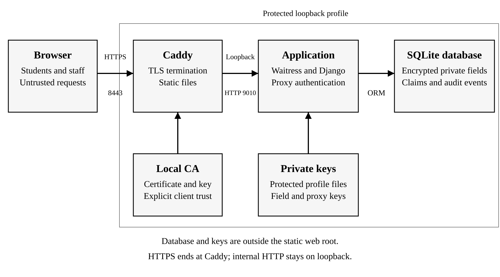
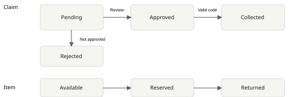

# ClaimSafe Secure Campus Lost Property Claim and Collection System

Security 6000CMD and 6005CEM

Secure Application Development and Implementation

25 October 2026

## 1 Introduction and system overview

A lost property service needs to disclose enough information for an owner to recognise an item without giving another person everything needed to claim it. Publishing a full serial number, distinctive engraving or description of private contents could make an ownership claim easier to imitate. ClaimSafe addresses this problem through a campus application that separates public item descriptions from private identifying records and requires staff approval before collection.

The application supports students, property officers and administrators. Students browse listings, submit descriptions of their belongings and follow their own claims. Officers record items already received into custody, assess ownership evidence and confirm handovers. Administrators have those operational capabilities and can also inspect security activity and control account activation. Registration creates a student account; privileged roles require local provisioning. These responsibilities provide a practical setting for examining authentication, authorisation, information disclosure and misuse of legitimate workflows.

The objectives are to restrict access to private claims, protect identifying information, prevent collection before approval, and ensure that one item cannot be handed over twice through the application. The design also addresses malicious input, session misuse and insufficient activity records. Security was considered during development of a new application, so the evaluation does not assume that an earlier, deliberately vulnerable version existed.

ClaimSafe uses server-rendered Django pages, a SQLite database and the cryptography library. The examined version uses Python 3.12.14, Django 5.2.18 and cryptography 46.0.7 on Windows. Its scope is one campus, text descriptions and collection in person. It does not process payments, accept identity-document uploads or automatically establish legal ownership. Demonstration records are fictional, and officers remain responsible for assessing claims.

The implemented workflow operates locally and is supported by automated tests and browser observations. Encrypted communication and deployment hardening remain incomplete. The report therefore evaluates the working application while distinguishing its verified behaviour from the infrastructure and vulnerability assessment work still required.

## 2 Security analysis and design

### Assets and trust boundaries

The main assets are account credentials, session identifiers, private item details, claim evidence, collection authorisations and audit records. Disclosure of identifying evidence could support a false claim, while an unauthorised state change could reserve or release an item incorrectly. Availability matters because staff need a consistent record when resolving competing claims and confirming a handover.

The browser is treated as untrusted. Hidden form fields, request identifiers and disabled buttons cannot establish a person's permissions. Authentication identifies an account, while authorisation determines whether that account may perform a particular operation on a particular record. OWASP recommends checking permissions for each request and denying access unless permission has been established (OWASP Foundation, n.d.-a). ClaimSafe applies role checks to staff functions and an ownership condition when a student requests a claim.

Figure 1 shows the application boundary. The application can decrypt private fields for authorised users, so it is not designed to conceal those records from an operator controlling both the server and its encryption key. The physical handover is another boundary: software records an officer's confirmation but cannot independently prove that the person standing at the desk is the rightful owner.



### Access and controlled disclosure

Table 1 summarises the access model. Students can read their own evidence and the staff message about their outcome. Officers can inspect private identifying information and claims, but cannot approve or confirm collection of their own claim. Administrators can restrict account access and review the audit dashboard. A staff role does not imply that every administrative operation is available.

Table 1 Role and resource access

| Capability | Student | Officer | Administrator |
| --- | --- | --- | --- |
| Browse public listings | Yes | Yes | Yes |
| Read private claims | Own claims | Operational claims | Operational claims |
| Read withheld item details | No | Yes | Yes |
| Review and confirm collection | No | Other people's claims | Other people's claims |
| View system audit and manage activation | No | No | Yes |

Public and private descriptions are stored separately. This makes disclosure a deliberate decision rather than relying on hiding information within a single page. Nevertheless, an officer could accidentally type an identifying detail into a public field. The form explains this distinction, but procedural review remains necessary. Encryption cannot correct an inappropriate decision to publish information.

This restriction reflects the least privilege principle discussed by Saltzer and Schroeder (1975): access should be limited to the authority needed for a task. For ClaimSafe, permission to submit a claim does not justify permission to inspect other students' evidence. Separating the account roles and then checking claim ownership provides a practical application of that principle, while the broader access given to property staff remains an explicit trust assumption.

### Threat priorities and workflow rules

The assessment considers unauthenticated attackers, students acting dishonestly, compromised staff accounts and mistakes by legitimate users. Table 2 uses qualitative priorities based on the affected assets and available attack paths. These are design judgements rather than measured attack probabilities. Releasing an item incorrectly and exposing private evidence receive immediate attention because they undermine the application's purpose directly.

Table 2 Prioritised threats

| Threat | Priority | Reason and proposed response |
| --- | --- | --- |
| Reading another person's claim | High | Exposes private evidence; enforce ownership on every retrieval |
| Skipping approval or repeating collection | High | Can release an item incorrectly; enforce state and single use |
| Account or session compromise | High | Exposes permitted actions; strengthen authentication and sessions |
| Injection and malicious displayed content | High | Threatens records or users; validate, parameterise and encode |
| Network interception | High | Local HTTP does not protect transmitted credentials; deploy HTTPS |
| Missing or altered audit records | Moderate | Weakens investigation; restrict access and improve log protection |

The workflow has explicit states. An item moves from available to reserved and then returned. A claim moves from pending to approved and collected, or from pending to rejected. Approval reserves the item and closes other pending claims without revealing the successful claimant. Figure 2 shows these permitted transitions. OWASP's business logic guidance recommends modelling workflows on the server and testing attempts to skip, repeat or race their steps (OWASP Foundation, n.d.-b).



Collection requires more than a valid session. Only the approved claimant can request a code, and an authorised officer must validate that code against the same claim. Expiry limits its lifetime, while recorded consumption prevents reuse. OWASP distinguishes limited validity from accepting an authorisation only once; the final execution must enforce both (OWASP Foundation, n.d.-d). The database transaction is therefore part of the security control.

### Data protection and environment design

Private evidence is encrypted before storage, while passwords use a dedicated password hashing mechanism. The distinction matters because staff need to recover evidence for assessment but never need to recover a user's original password. The design uses maintained library functions rather than a custom encryption algorithm. Key compromise, backup handling and authorised staff access remain separate risks.

Malaysia's published personal data protection guidance identifies notice, disclosure, security, retention, integrity and access among its principles (Ministry of National Unity, n.d.). These inform the proposed handling of campus records: collect limited information, explain its purpose and restrict its audience. Whether a real deployment falls within particular legal obligations depends on the operator and processing context. A fictional prototype and a privacy checkbox do not demonstrate compliance.

The intended deployment requires HTTPS, a trusted certificate, a protected application identity and restricted access to the database and keys. These controls address boundaries that application permissions alone cannot protect. Their importance is reflected in the assessment, although the current local environment does not yet provide evidence that they have been configured successfully.

## 3 Security implementation and testing

### Account creation and session management

Registration uses an explicit form field list and sets the account role to student on the server. Extra request parameters cannot turn registration into an administrator provisioning route. The registration test supplies privileged fields deliberately and confirms that the resulting account remains a student without staff or superuser flags. Officer and administrator accounts are created through a management command with an interactively entered password.

Passwords are handled through Django's password API. Its default storage uses PBKDF2 with SHA-256 and a salt rather than a reversible password field (Django Software Foundation, n.d.-b). Tests confirm that the stored value differs from the password and that legitimate verification succeeds. The current form rejects common, numeric and account-similar passwords and requires at least twelve characters. That length is an implemented setting, not a claim of alignment with every authentication standard.

Login attempts are limited through database counters keyed from account or network identifiers using a keyed hash. The account window allows five attempts in fifteen minutes, while the network window allows thirty. Requests already blocked by the network limit do not allocate additional account counters. Failed attempts and throttling outcomes generate audit events without recording submitted passwords. These limits also affect legitimate repeated attempts and require operational review before real use.

Django changes the session identifier at login, and logout invalidates the session. ClaimSafe adds an authentication timestamp and rejects sessions older than eight hours, while configured session expiry provides a thirty-minute inactivity boundary. Session cookies use HttpOnly and SameSite settings. Automated checks cover session rotation, logout and absolute expiry. Deactivated accounts also lose authenticated access on subsequent requests. Secure cookie transmission remains dependent on the unfinished HTTPS deployment.

### Authorisation and private record access

Claim retrieval is scoped before the record is returned. For a student, the query includes the authenticated claimant; officers use the operational view after the staff permission check. A request for another student's claim receives a generic unavailable-page response. The corresponding test signs in as a different student, requests the exact claim identifier and verifies that the response contains no private evidence.

Registration, claim status and officer permissions are never accepted from client assertions. State-changing operations require POST, and staff routes reject student accounts even when called directly. Officers cannot open the administrator audit view or change account activation. Administrators cannot deactivate themselves or another administrator through the provided route. The database supplies an additional unique constraint so that an item cannot have two approved or collected claims.

### Input handling and safe responses

Django forms check required values, length limits and recognised choices. Claim evidence is limited to 2,000 characters, public descriptions to 300, and future found dates are rejected. The purpose is to constrain the data expected by each operation while preserving meaningful descriptions. Security does not depend on deleting a small set of suspicious characters.

Database lookups use Django's object relational mapper (ORM) rather than concatenating user text into SQL. Django explains that query parameterisation separates query structure from supplied values (Django Software Foundation, n.d.-c). The search regression test supplies SQL-like input, observes no matching records and confirms that the item table remains intact. This demonstrates that particular path and input; broader assessment is still needed.

Templates retain automatic escaping, and user text is not marked as trusted HTML. The stored-script test places script-like text in encrypted evidence and confirms that its displayed response contains encoded markup. A Content Security Policy also disallows script execution. Django's cross-site request forgery (CSRF) middleware protects submitted forms, and a test using enforced CSRF checks rejects a staff review without its token. Custom error pages avoid sending tracebacks to visitors. These controls complement one another rather than making validation a substitute for output encoding or authorisation.

### Private evidence and key handling

Identifying details, claim evidence and review messages are encrypted with Fernet before they are written to the database. Fernet combines AES-128-CBC encryption with HMAC-SHA256 authentication and random initialisation values (Python Cryptographic Authority, n.d.). The application delegates the cryptographic construction to the library. A test verifies recovery of the original evidence and rejection of a modified encrypted value.

Local setup generates a field encryption key independently of Django's secret key. It does not overwrite existing key material and refuses to generate replacement keys beside an existing database missing its secrets. The keys, database, demonstration passwords and virtual environment are excluded from Git. This prevents accidental version-control disclosure, although those files remain within the same local checkout area. Their host permissions and backup separation have not been independently established.

The privacy page explains the data collected, authorised audiences and the limits of encryption. Forms warn against submitting passwords, device PINs, payment information or identity numbers. The application deliberately excludes document uploads, avoiding an unnecessary source of sensitive data and file-handling complexity. Retention, deletion and correction procedures remain incomplete and require a documented operator policy.

### Approval and collection integrity

Approval is performed inside a database transaction. The service checks the reviewer, rejects self-review and changes an available item to reserved using a conditional update. If that update fails, approval stops. A unique winning-claim constraint provides a second check on the resulting records. The application then closes competing pending claims with a neutral message. This maintains a consistent outcome without publishing another claimant's identity.

Collection codes are generated from twenty-four random bytes, producing 192 bits of random input before text encoding. Only the SHA-256 digest is stored. A code belongs to one approved claim, expires after fifteen minutes and is displayed only in the generating response. Generating a replacement invalidates the previous code. The response is marked no-store, and the code is excluded from the audit event.

The officer must provide that code and confirm the physical handover. The transaction conditionally consumes an unused, unexpired matching digest, changes the approved claim to collected, changes the reserved item to returned and records the completed collection. Any failed required update rolls the transaction back. Figure 3 records the resulting state during a fictional browser walkthrough; it illustrates the completed workflow rather than proving physical ownership.


SQLite is configured to use IMMEDIATE transactions. This acquires the write reservation before the transaction's decision reads, while conditional updates still verify the expected state. Django documents that SQLite does not implement SELECT FOR UPDATE row locking, so relying on that mechanism here would be misleading (Django Software Foundation, n.d.-a). The concurrent test uses separate connections and a shared start barrier. One collection succeeds, the other is rejected, and one completion event remains.

### Logging and security analytics

The audit model records the actor, action, target, outcome and timestamp. Events include login failures, access denials, private evidence access, claim decisions and collection completion. Students see their own activity, while the system audit dashboard is restricted to administrators. It provides outcome filtering and totals for recorded events, denied attempts and authorised handovers.

Passwords, collection codes and evidence text are excluded from these events. This follows OWASP's distinction between recording security activity and exposing secrets through logs (OWASP Foundation, n.d.-c). Figure 4 shows the dashboard during the fictional walkthrough; its totals represent that capture, not a measured attack rate. The database remains modifiable by its operator, so restricted dashboard access does not provide an independently tamper-proof audit trail.


### Communication and host protection

The examined server was bound to 127.0.0.1 and used HTTP for local development. DEBUG was disabled, allowed hostnames were restricted, and responses included framing, content-type and content-policy protections. A production settings switch enables HTTPS redirection, Secure cookies and HTTP Strict Transport Security (HSTS). However, no deployed certificate, trusted Transport Layer Security (TLS) endpoint or hardened production server has been verified. Those settings cannot be presented as completed secure communication.

The next deployment must terminate HTTPS through a correctly configured server, serve only intended static resources, protect key and database paths and use a dedicated application identity. Certificate trust, hostname, expiry, redirects and cookie behaviour must then be inspected. Proxy forwarding settings should be trusted only where the proxy removes untrusted client headers. This remains required implementation and evidence work before submission.

### Test method and observed outcomes

The evidence baseline is repository commit d1086b5. On 25 October 2026, the Django test runner executed forty-five tests successfully in 12.129 seconds using a separate SQLite test database. This duration describes that run only and is not an application performance benchmark. Selected boundary checks and outcomes are summarised in Table 3. The complete test source identifies the assertions and setup rather than relying on screenshots alone.

Table 3 Selected automated checks from the passing test run

| Check | Observed result |
| --- | --- |
| Student requests another student's claim | Generic 404 response; evidence absent |
| Registration supplies administrator fields | Account remains a student |
| Script-like evidence is displayed | Markup encoded; script execution disallowed |
| Staff review omits a CSRF token | Request rejected with status 403 |
| Expired, replaced or wrong-claim code is used | Collection rejected |
| Failed final state update | Code consumption and claim update rolled back |
| Two connections collect the same claim | One success, one rejection, one completion event |
| Account is deactivated with an existing session | Authenticated access denied on the next request |

Browser observation separately exercised student and officer sign-in, code generation, a fictional handover and the administrator dashboard. The home layout was also inspected at desktop size and a 390-pixel mobile viewport. These observations establish visible behaviour in that environment; no independent usability study or physical campus trial was conducted.

The remaining assessment should combine manual request manipulation with an automated web scan and dependency vulnerability audit. OWASP's testing guide provides an appropriate reference for selecting and recording cases (OWASP Foundation, n.d.-e). These activities have not yet produced results. The current regression tests must therefore not be described as a completed penetration test or comprehensive OWASP assessment.

## 4 Discussion and improvement

### Effectiveness and design tradeoffs

The implementation addresses the main disclosure and collection risks through linked controls. A public item listing does not expose the withheld record, a student's access depends on claim ownership, and an officer cannot complete collection merely by selecting a status. The passing negative tests support these specific boundaries. The browser walkthrough also shows that a legitimate claimant and officer can complete the intended process.

Those controls affect usability. Withholding identifying details may make a listing harder to recognise, and a staff review delays collection compared with an automatic match. These costs are justified where publishing more information would weaken ownership assessment. Nevertheless, a person who already knows the identifying details could submit convincing evidence. The system assists an officer's decision and records it; it does not remove the need for judgement.

The concurrency design required attention to the actual database rather than assuming that all transaction APIs behave identically. IMMEDIATE transactions and conditional updates provide the tested local behaviour, but SQLite serialises writers and is not evidence of suitability for heavy concurrent use. A database change would require a fresh review of locking, transaction isolation and failure handling. Similarly, a correctly hashed password does not compensate for an unencrypted connection.

### Remaining security gaps

The password setting is a concrete improvement area. ClaimSafe currently accepts twelve-character passwords without MFA. NIST's 2025 guidance specifies at least fifteen characters for passwords used as a single authentication factor (NIST, 2025). That guidance is a technical benchmark rather than a statement of this application's legal obligations. Increasing the minimum, reviewing compromised-password screening and introducing MFA for privileged accounts would strengthen the authentication design.

Other gaps concern operation over time. The prototype has no protected external log copy, automated alerting, tested backup recovery or implemented key rotation. Old rate counters also require periodic cleanup. The privacy notice identifies data use but is not accompanied by an established retention schedule or complete deletion and correction process. These matters should be resolved with the intended operator before processing real records.

The OWASP Top 10 2025 provides a useful classification of these concerns: access control and injection have targeted checks, while misconfiguration, cryptographic protection, supply-chain review and logging still require broader evidence (OWASP Foundation, 2025). The categories are not a certification scheme. Successful tests for selected inputs do not show that an entire category has been eliminated.

### Prioritised improvement work

The immediate priority is verified HTTPS and host protection because the existing HTTP environment leaves transport confidentiality unproven. The next priority is the manual and automated assessment, with findings recorded, corrected and retested against a named version. Authentication improvements should follow, including the password-length gap and privileged-account MFA. These changes should preserve the existing ownership and collection regression tests.

Operational improvements should then separate key protection from ordinary source storage, test restoration from protected backups and define practical retention and deletion procedures. External log protection and meaningful alerts would improve detection and investigation. Each improvement needs evidence appropriate to its purpose: a restore exercise for recovery, a rejected unauthorised request for permissions, and an inspected TLS connection for communication. Adding more feature names would not establish those outcomes.

## 5 Summary

ClaimSafe implements a campus lost-property workflow in which public discovery is separated from private ownership assessment. Students can submit and follow their own claims, officers can assess evidence and confirm another person's collection, and administrators can inspect security activity and restrict account access. The application's distinctive security requirement is that approval and physical handover must remain controlled even when a user sends requests outside the visible interface.

The local implementation combines framework authentication, ownership checks, validated forms, escaped output, encrypted private fields and recorded security events. Its collection service binds an expiring code to an approved claim and changes the related records within one transaction. Forty-five automated tests passed, including a two-connection collection case, and a fictional browser walkthrough demonstrated a permitted handover.

These results support the implemented application's behaviour within its tested environment. Secure communication, deployment hardening and a complete manual and automated vulnerability assessment remain unfinished. The host or network security learning outcome is therefore only partly evidenced at this stage, while the application demonstrates working solutions to several common security concerns. Completing those remaining controls and reassessing the final version will provide a stronger basis for the submitted report and viva.

## References

Django Software Foundation (n.d.-a) Databases. Available at: https://docs.djangoproject.com/en/5.2/ref/databases/ (Accessed: 25 October 2026).

Django Software Foundation (n.d.-b) Password management in Django. Available at: https://docs.djangoproject.com/en/5.2/topics/auth/passwords/ (Accessed: 25 October 2026).

Django Software Foundation (n.d.-c) Security in Django. Available at: https://docs.djangoproject.com/en/5.2/topics/security/ (Accessed: 25 October 2026).

Ministry of National Unity (n.d.) Personal Data Protection. Available at: https://www.perpaduan.gov.my/index.php/en/services/other-services/e-participation/personal-data-protection (Accessed: 25 October 2026).

National Institute of Standards and Technology (NIST) (2025) Digital Identity Guidelines Authentication and Authenticator Management. NIST SP 800-63B-4. Available at: https://pages.nist.gov/800-63-4/sp800-63b.html (Accessed: 25 October 2026).

OWASP Foundation (2025) OWASP Top 10 2025. Available at: https://top10.owasp.org/2025/ (Accessed: 25 October 2026).

OWASP Foundation (n.d.-a) Authorization Cheat Sheet. Available at: https://cheatsheetseries.owasp.org/cheatsheets/Authorization_Cheat_Sheet.html (Accessed: 25 October 2026).

OWASP Foundation (n.d.-b) Business Logic Security Cheat Sheet. Available at: https://cheatsheetseries.owasp.org/cheatsheets/Business_Logic_Security_Cheat_Sheet.html (Accessed: 25 October 2026).

OWASP Foundation (n.d.-c) Logging Cheat Sheet. Available at: https://cheatsheetseries.owasp.org/cheatsheets/Logging_Cheat_Sheet.html (Accessed: 25 October 2026).

OWASP Foundation (n.d.-d) Transaction Authorization Cheat Sheet. Available at: https://cheatsheetseries.owasp.org/cheatsheets/Transaction_Authorization_Cheat_Sheet.html (Accessed: 25 October 2026).

OWASP Foundation (n.d.-e) Web Security Testing Guide. Available at: https://owasp.org/projects/web-security-testing-guide (Accessed: 25 October 2026).

Python Cryptographic Authority (n.d.) Fernet symmetric encryption. Available at: https://cryptography.io/en/latest/fernet/ (Accessed: 25 October 2026).

Saltzer, J.H. and Schroeder, M.D. (1975) The protection of information in computer systems. Proceedings of the IEEE, 63(9), pp. 1278-1308. Available at: https://web.mit.edu/Saltzer/www/publications/protection/ (Accessed: 25 October 2026).

## Appendix A Implementation extracts

The extracts below are from core/services.py in the examined repository version, with line breaks adjusted for readability. They illustrate checks discussed in Section 3; the complete function and transaction remain necessary to understand the control.

### Claimant restriction for issuing collection codes

```python
if (
    not actor.is_authenticated or not actor.is_active
    or claim.claimant_id != actor.pk
):
    raise WorkflowError(
        "Only the approved claimant can generate a collection code.", 403
    )
if claim.status != Claim.Status.APPROVED:
    raise WorkflowError(
        "A collection code requires an approved, uncollected claim."
    )
```

### Conditional consumption within the collection transaction

```python
changed = CollectionGrant.objects.filter(
    claim=claim, digest=hashlib.sha256(token.encode()).hexdigest(),
    used_at__isnull=True, expires_at__gt=now,
).update(used_at=now)
if changed != 1:
    raise WorkflowError(
        "The collection code is invalid, expired or already used.", 400
    )
```

## Appendix B Assistance acknowledgement and submission materials

OpenAI Codex assisted with project planning, application implementation, automated test creation, documentation and preparation of this report draft. The assistance should be declared using the module's required Generative AI Declaration Form. The submitting student must review the explanations, verify the references and demonstrate their understanding and contribution during the viva.

The final submission also requires the student's completed cover details, the Turnitin plagiarism screenshot and the Generative AI Declaration Form. These materials are not reproduced here. Verified HTTPS, host protection and vulnerability assessment evidence must be added when that work is completed, and the report's findings and conclusion must then be revised accordingly.
